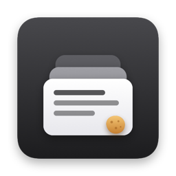
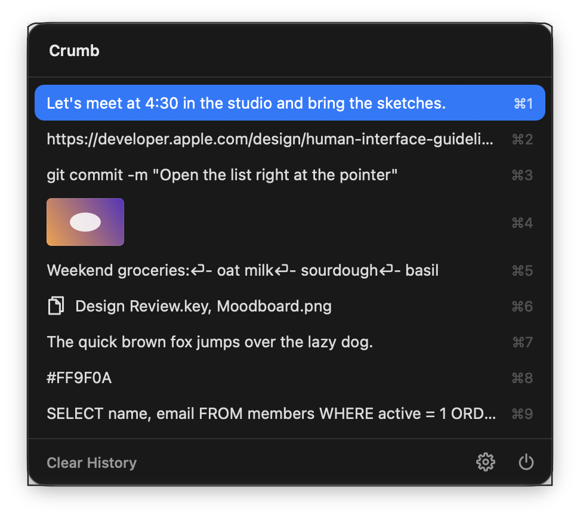
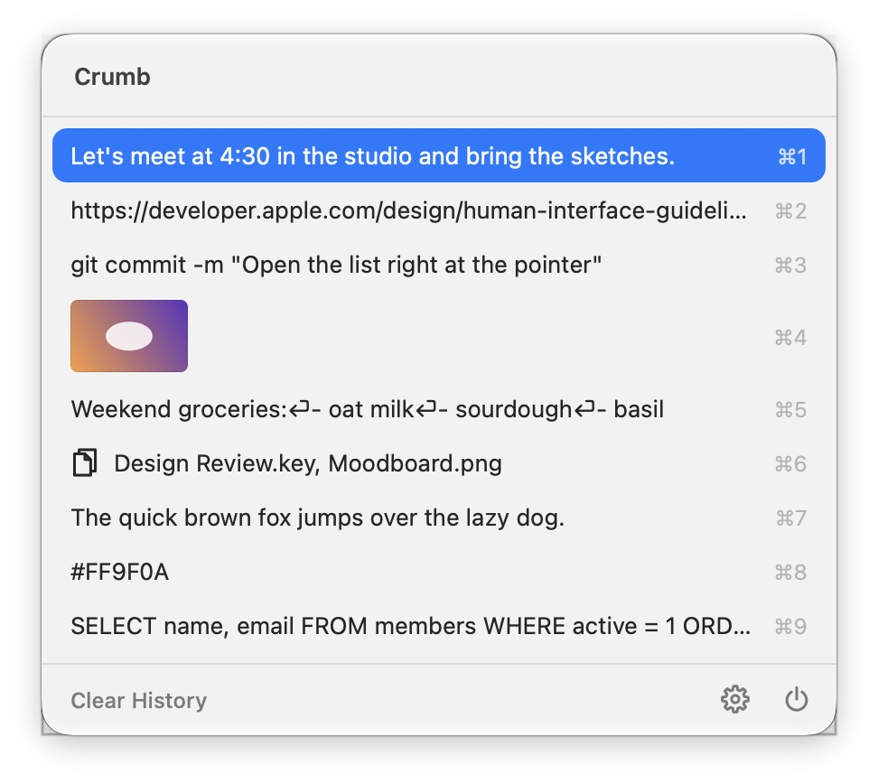
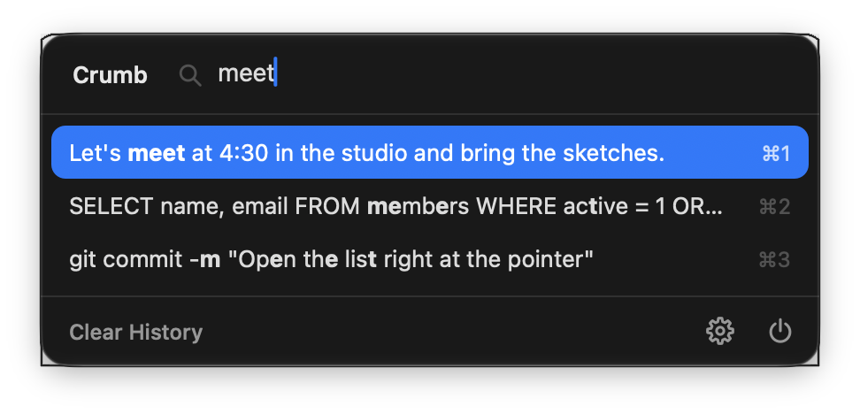
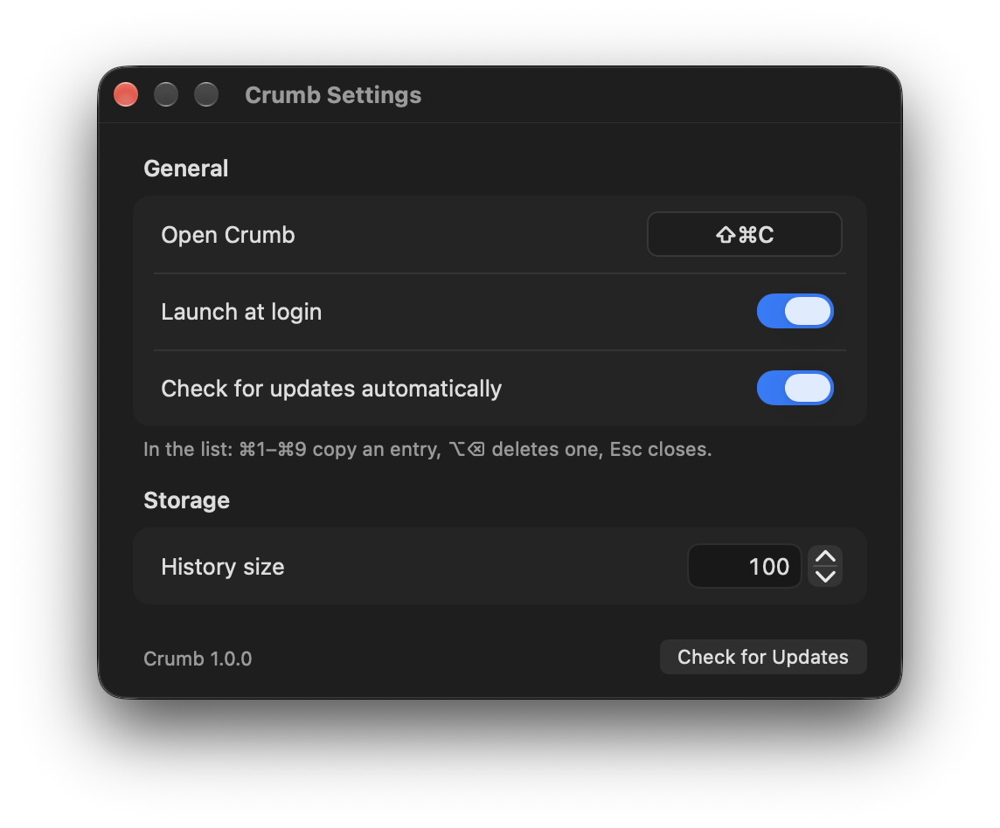

<p align="center"></p>

<h1 align="center">Crumb</h1>

<p align="center"><b>A tiny clipboard history for your Mac.</b><br>
Press <kbd>⇧</kbd><kbd>⌘</kbd><kbd>C</kbd> anywhere to see everything you copied: text, pictures and files.<br>
Under 400 KB on disk, 10 to 20 MB of memory, no CPU while idle.</p>

<p align="center">
  
  
</p>

## What it does

- **Opens at the pointer** with <kbd>⇧</kbd><kbd>⌘</kbd><kbd>C</kbd> (pick any shortcut in Settings). It appears and
  disappears instantly, with no animations.
- **⌘1 to ⌘9** copy one of the first nine entries. <kbd>↑</kbd> <kbd>↓</kbd> and <kbd>Return</kbd>, or a click,
  copy any of them. <kbd>Esc</kbd> closes the list and <kbd>⌥</kbd><kbd>⌫</kbd> deletes the selected entry.
- **Just type to search.** The search field appears as you type. Search is fuzzy: type a few letters in order
  (`gcm` finds `git commit -m`) and the matched letters are shown in bold.
- **Hover over an entry, or select it, for three seconds** to see the whole text or the full-size picture.
- **Keeps everything you copy, in full**: text of any length (with its formatting), pictures and files, newest
  first. Copying something again moves it back to the top.
- **Clear History** sits at the bottom of the list.

<p align="center">
  
  
</p>

Settings has only what you need: the shortcut, launch at login, automatic updates and how many entries to keep
(100 by default).

## Private by design

- Your history never leaves your Mac. It lives in `~/Library/Application Support/Crumb`, a few small files per
  entry, and only your user account can read it.
- Passwords stay out. Password managers mark what they copy as concealed or transient (see
  [nspasteboard.org](http://nspasteboard.org)), and Crumb never saves it.
- The only connection Crumb makes is a daily check of this repository's releases, and you can turn that off in
  Settings. Updates are signed: Crumb installs a new version only if its download carries a valid signature
  from the project's release key.
- No accounts, no telemetry, no ads. Crumb is free and open source under the MIT License.

## Install

Crumb runs on macOS 13 or later.

**Download:** grab `Crumb.zip` (Apple silicon) or `Crumb-Intel.zip` (Intel) from the
[latest release](../../releases/latest), unzip it and move `Crumb.app` to Applications. Crumb isn't notarized by
Apple, so the first time you open it macOS asks you to confirm: open it once, then choose **Open Anyway** in
System Settings → Privacy & Security.

**Or build it yourself** with the Xcode command line tools (`xcode-select --install`):

```sh
git clone https://github.com/bhaskar0210s/crumb.git
cd crumb
make install    # builds Crumb.app, copies it to /Applications and starts it
```

The first launch from Applications adds Crumb to your login items and shows its settings once. Crumb has no
Dock icon and no menu bar icon: press the shortcut to use it, and open the app again (from Spotlight or Finder)
whenever you want its settings.

## How it stays small

- **Native code only.** A C++ core keeps the history and does the searching; a thin AppKit layer draws the list
  with Core Text. No web views, no third-party libraries.
- **Only a little lives in memory.** Each entry keeps its first few kilobytes in memory for drawing and searching;
  full texts and pictures stay on disk until you preview or copy them. Pictures are shrunk once into small
  thumbnails for the list.
- **Nothing is kept around while the list is closed.** Its window is torn down on close and rebuilt, undrawn, in
  the background, so it opens in a few milliseconds without holding any buffers in between.
- **Cheap watching.** macOS doesn't announce copies, so Crumb reads the pasteboard's change count twice a
  second, which costs next to nothing.

Measured in Activity Monitor on an Apple silicon Mac running macOS 27, with 100 entries saved: about 9 MB right
after launch and about 20 MB once the list has been opened (the system's text and graphics caches load on first
use), steady over hundreds of opens. CPU use while idle is 0.0%.

## Tested

- `make test` runs the core's unit tests (history storage, fuzzy search, text handling and version checks) with
  AddressSanitizer and UndefinedBehaviorSanitizer.
- `leaks` finds nothing from Crumb after hundreds of opens, searches, previews and copies. It does report a few
  cycles inside Apple's AppIntents framework that every AppKit app gets on macOS 27.
- Stress tests cover a 55 MB text, an 8K picture and 100 entries copied back to back. Every byte is kept, and
  the list still opens in about 15 ms.

## Development

```sh
make              # build/Crumb.app (add ARCH=x86_64 for Intel)
make run          # build and start it from build/
make test         # unit tests
make icon         # redraw resources/Crumb.icns
```

`src/core` holds the history store and the fuzzy search (plain C++), and `src/app` the AppKit side. Pushing a tag
such as `v1.0.1` builds both downloads on GitHub, signs them and publishes a release. Installed copies with
automatic updates turned on install it within a day.

Releases are signed with an ECDSA P-256 key kept in the repository secret `UPDATE_SIGNING_KEY` (PEM). Its public
half is `CrumbUpdateKey` in `resources/Info.plist`. A fork that publishes its own releases needs its own key pair:

```sh
openssl ecparam -name prime256v1 -genkey -noout -out update-key.pem             # keep this private
openssl ec -in update-key.pem -pubout -outform DER | tail -c 65 | base64        # goes into Info.plist
```

## License

[MIT](LICENSE)
